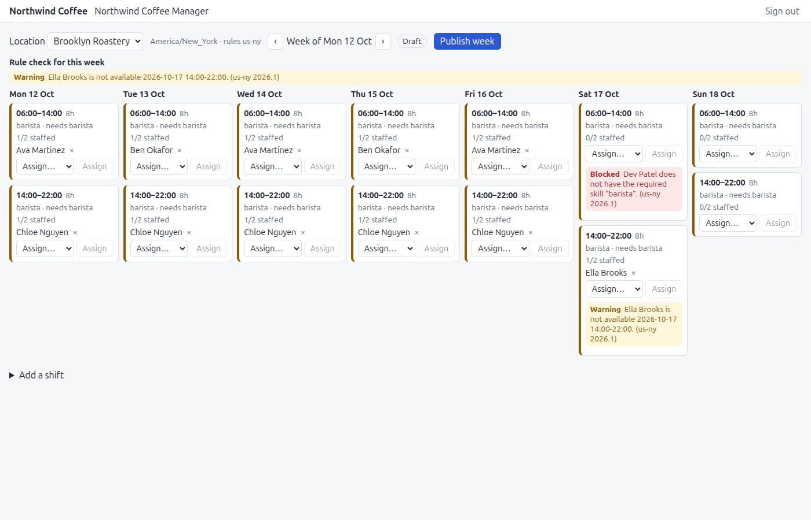
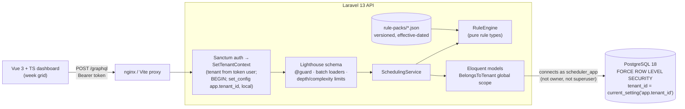
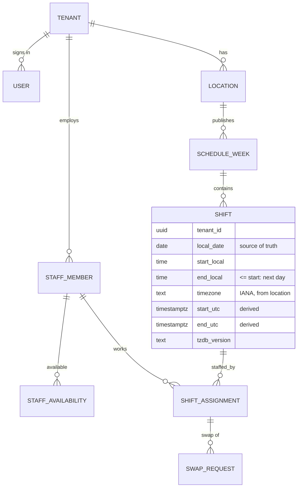

# workforce-scheduler-saas

A multi-tenant staff-scheduling SaaS: **Laravel 13 GraphQL API (Lighthouse) + Vue 3 / TypeScript dashboard**, on
PostgreSQL 18 with **row-level security** as a second line of tenant isolation.

Employers (tenants) have locations, staff (roles, skills, availability, contracted hours, minors) and weekly
schedules of shifts. Assigning someone to a shift is checked against a versioned **labour-rule pack** (maximum
weekly hours, minimum rest between shifts, minor-worker limits, skills). Managers publish a week; staff can request
swaps.

It implements a working slice of a system design I wrote up separately:
[Multi-tenant workforce scheduling SaaS](https://github.com/adilKhan72/system-design-notes/tree/main/designs/multi-tenant-workforce-scheduling-saas)
(tenancy model, wall-clock time + IANA zone storage, rule packs).



## Architecture



Two independent tenant-isolation layers: the Eloquent scope (primary control) and RLS (backstop). Tests bypass
the first on purpose (`DB::select`, `withoutGlobalScopes()`) to prove the second holds.

### Data model



Every tenant-owned table has `tenant_id`, forced RLS, and composite foreign keys `(tenant_id, parent_id)`, so a row
cannot reference another tenant's row even if RLS were off.

## Design decisions

| ADR | Decision |
|---|---|
| [0001](docs/adr/0001-shared-schema-tenancy-with-postgres-rls.md) | Shared schema, `tenant_id` everywhere; app-level scope **and** PostgreSQL RLS (`FORCE`, transaction-local `app.tenant_id`, non-owner runtime role) |
| [0002](docs/adr/0002-local-wall-clock-time-plus-iana-zone.md) | Shifts stored as local date/time + IANA zone; UTC instants derived; DST-skipped times rejected |
| [0003](docs/adr/0003-graphql-with-lighthouse.md) | Schema-first GraphQL with Lighthouse; batch loading; violations as typed data |
| [0004](docs/adr/0004-labour-rules-as-versioned-rule-packs.md) | Rules as small pure classes; parameters as versioned, effective-dated JSON packs |

## Roadmap

- [x] **M1** Domain model, tenancy (scope + middleware + RLS), DST-aware shift times, CI on PostgreSQL 18
- [x] **M2** GraphQL API (Lighthouse + Sanctum), rule engine and packs, publish week, swap requests
- [x] **M3** Vue 3 week-grid dashboard (assign staff, see violations, publish)

## GraphQL API

Schema-first with Lighthouse: [`api/graphql/schema.graphql`](api/graphql/schema.graphql). One endpoint,
`POST /graphql`, Sanctum bearer token. The tenant is taken from the token's user; another tenant's ids return the
same generic `Not found.` as ids that don't exist.

**The week grid** (7 SQL queries whether the week has 2 shifts or 200; a test enforces that the count does not grow):

```graphql
query Week($locationId: ID!, $weekStart: String!) {
  schedule(locationId: $locationId, weekStart: $weekStart) {
    weekStart status publishedVersion
    shifts {
      id localDate startLocal endLocal durationMinutes crossesDstTransition headcount requiredSkill
      assignments { id staffMember { id name skills } }
    }
    violations { rule severity message shiftIds }
  }
}
```

**Assigning staff** returns rule violations as typed data. Blocking ones refuse the change; warnings come back with
the new assignment:

```graphql
mutation { assignStaff(shiftId: "…", staffMemberId: "…") {
  blocked
  assignment { id }
  violations { rule severity packId packVersion message shiftIds }
} }
```

```json
{ "blocked": true, "assignment": null, "violations": [{
  "rule": "minor_worker_restrictions", "severity": "BLOCK", "packId": "us-ny", "packVersion": "2026.1",
  "message": "Ella (age 15) cannot work past 22:00. (us-ny 2026.1)" }] }
```

Other operations: `createShift` (local time; DST-skipped times rejected), `unassignStaff`, `publishWeek` (full
re-check; refused while any blocking violation remains; later edits put the week back to draft and re-publishing
bumps `publishedVersion`), `requestSwap` / `approveSwap` (re-runs the rules for the incoming person) / `rejectSwap`.

Limits: max depth 8, max complexity 300, introspection disabled when `APP_ENV=production`.

### Rule packs

[`api/resources/rule-packs/`](api/resources/rule-packs): versioned, effective-dated JSON per jurisdiction
(`us-ny` 2025.1 and 2026.1, `gb` 2026.1) over seven pure rule types: no overlapping shifts, required skill,
minimum rest, max hours per day/week, minor-worker restrictions (age on the shift date; daily/weekly hours,
earliest start, latest end) and availability. Illustrative and simplified, **not legal advice**.

## Dashboard

`dashboard/`: Vue 3 + TypeScript (Vite), no UI framework. Week grid per location: navigate weeks, add shifts,
assign or remove staff, see each assignment's rule result next to the shift and the full week check above the grid,
publish (disabled while blocking violations remain). Shifts that span a DST change show a **DST** marker and their
real duration. "This week" is computed in the location's zone, not the browser's. The API is same-origin (Vite
proxy in development, nginx in the container), so there is no CORS and the token is never sent to another host.

## Run it

```bash
make key        # .env with a fresh APP_KEY
make up         # postgres 17, migrations (as owner), API :8000 (as the runtime role), dashboard :5173
make seed       # two demo tenants
```

Open http://localhost:5173 and sign in as `manager@northwind.test` / `password` (New York, `us-ny` rules) or
`manager@harbour.test` / `password` (London, `gb` rules). Each sees only their own tenant.

For development: `cd dashboard && npm install && API_URL=http://localhost:8000 npm run dev`.

## Tests

```bash
make test-api      # Pint + tests on SQLite (fast; RLS suite skipped with a reason)
make test-api-pg   # full suite on the compose PostgreSQL 18, as CI runs it
make test-dashboard  # vitest + vue-tsc + vite build
```

CI runs everything on PostgreSQL 18 and fails if any test is skipped there.

## What is verified, and what is not

- **Verified by tests (CI, PostgreSQL 18):** 78 API tests (tenancy scope; RLS with the scope bypassed, as the
  runtime role; DST maths; every rule type; GraphQL queries and mutations incl. cross-tenant ids; an N+1 guard;
  depth and complexity limits) and 24 dashboard tests (vitest).
- **Verified by hand:** the dashboard against a real API and PostgreSQL 18 (API connected as `scheduler_app`):
  sign-in, week grid, a blocked assignment (missing skill), a warning (outside availability), publishing v1, and an
  added 22:00-06:00 shift on 31 Oct 2026 showing 9h with a DST marker. A cross-tenant schedule request returned
  `Not found.`. The screenshot above is from that run.
- **Not verified:** `docker compose up` end to end (CI builds the images; locally I ran the pieces separately to stay
  within memory limits), concurrent assignment under load, and any performance figure.

## Limitations

- Rule packs are illustrative and simplified (no 17-week averaging, no fair-workweek premiums, hours counted on the
  day a shift starts). **Not legal advice.**
- One role (manager). No staff self-service, notifications, clock-in or payroll export from the design write-up.
- Shift `version` is exposed but optimistic locking is not enforced; there is no change-history table.
- Recomputing derived UTC times after a tzdata update is described (ADR-0002), not implemented.
- `php artisan serve` in the API image is dev-grade; production would use php-fpm or FrankenPHP.

## License

MIT
